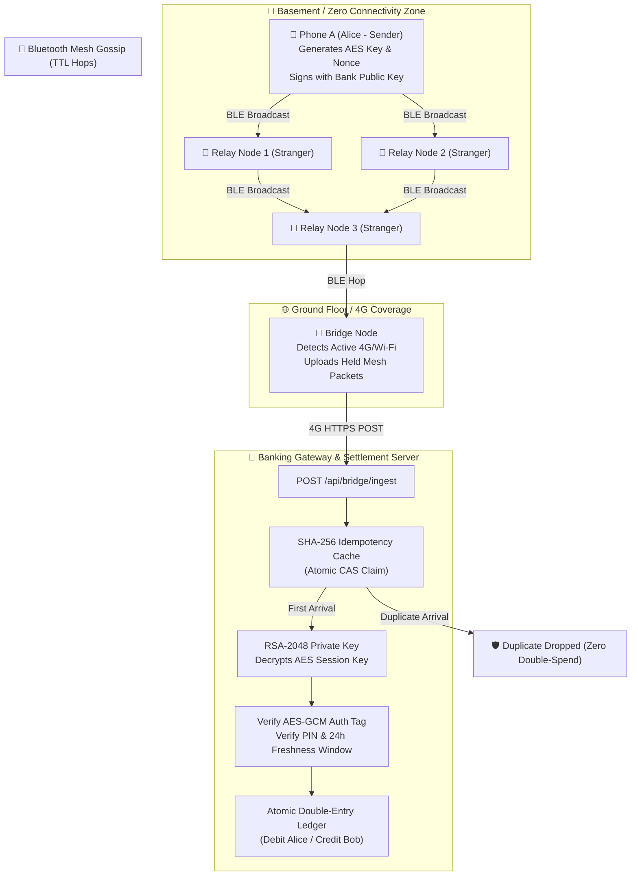

# BharatMesh Pay — Offline UPI Payments via BLE Mesh Network

[](https://www.oracle.com/java/)
[](https://spring.io/projects/spring-boot)
[]()
[](https://www.docker.com/)
[]()

> **Author**: Vaishnavi Singh  
> **Project**: BharatMesh Pay (Offline-First UPI Mesh Network Engine)  
> **Status**: Production-Ready Prototype & Interactive Simulator  

---

## 📌 Executive Summary

India's Unified Payments Interface (UPI) handles billions of transactions monthly, but is fundamentally dependent on constant cellular or Wi-Fi connectivity. When a user is in a basement parking lot, a remote rural outpost, an underground metro, or an emergency disaster zone with collapsed telecommunications, digital payments fail completely.

**BharatMesh Pay** solves this problem through an **offline-first store-and-forward Bluetooth Low Energy (BLE) mesh network**:

1. A payer in a zero-connectivity environment enters an amount and PIN.
2. The sender's phone cryptographically signs and seals the payment in an encrypted envelope using **Hybrid RSA-2048 OAEP + AES-256-GCM**.
3. The encrypted payload hops device-to-device across nearby stranger phones via BLE mesh broadcasts (each hop decrementing a Time-To-Live counter).
4. Intermediary phones **cannot read** the amount, sender, recipient, or PIN, and **cannot tamper** with the packet.
5. As soon as *any* participating phone walks into cellular/Wi-Fi coverage (the "Bridge Node"), it securely uplinks the packet to the banking settlement server.
6. The backend decrypts, validates freshness, atomically prevents double-spends using **SHA-256 Idempotency Hashing**, and settles the transaction on the ledger.

---

## 🏛️ System Architecture



---

## 🔐 The Three Core Security Pillars

| # | Security Challenge | Threat Vector | Technical Defense in BharatMesh Pay |
|---|---|---|---|
| **1** | **Zero-Trust Relay Privacy** | Untrusted stranger phones snooping on transaction details or PINs. | **Hybrid Envelope Cryptography**: A random 256-bit AES-GCM session key encrypts the payment instruction. That session key is wrapped in the Bank's 2048-bit RSA-OAEP public key. Relay nodes only see opaque random bytes. Any packet modification breaks the GCM authentication tag. |
| **2** | **Duplicate Storm & Double-Spends** | In a gossip mesh, multiple phones might reach 4G simultaneously and upload the same transaction. | **Atomic SHA-256 Idempotency Claim**: The backend computes `SHA-256(ciphertext)`. An atomic compare-and-set claim guarantees exactly **one** upload executes settlement; all parallel duplicates are discarded without touching user balances. |
| **3** | **Replay & Freshness Attacks** | An attacker capturing an old packet and re-submitting it days later. | **Nonce & Freshness Window**: Each packet embeds a cryptographically random UUIDv4 nonce and epoch millisecond timestamp signed offline. The bank rejects any packet older than 24 hours (`86,400s`) or re-using a nonce. |

---

## ✨ Features & Interactive UI

The application includes **BharatMesh Pay Studio**, an operations and simulation dashboard accessible at `http://localhost:8080`:

- **Real-Time HTML5 Topology Canvas**: Interactive 60 FPS visual graph representing physical relay devices, link distances, radar waves for 4G gateways, and animated packet particles traveling between phones.
- **Air-Gapped Mobile Simulator**: Smartphone mock interface with quick amounts (`₹100`, `₹250`, `₹500`, `₹1,000`, `₹2,000`), masked 4-digit UPI PIN pad, and live cryptographic payload inspector.
- **Settlement Ledger & Cryptographic Proofs**: Audit trail showing transaction status (`SETTLED`, `DUPLICATE_DROPPED`, `REJECTED`), bridge device ID, mesh hops traversed, and a verification receipt modal.
- **One-Click Interactive Auto-Tour**: Automated walkthrough demonstrating injection, multi-hop gossiping, gateway uplink, idempotency duplicate drop, and bank settlement with audio cues and celebratory confetti.
- **Zero-Setup Database**: Built-in H2 in-memory relational database with an embedded console available at `/h2-console`.

---

## 🚀 Quickstart & Running Locally

### Prerequisites
- **Java 17 or Java 21 LTS** installed (`java -version`).
- No external database or Maven installation required (the included Maven Wrapper handles dependencies automatically).

### Run on Windows
```powershell
.\mvnw.cmd spring-boot:run
```

### Run on macOS / Linux
```bash
chmod +x mvnw
./mvnw spring-boot:run
```

### Access the Application
- **Main Dashboard**: [http://localhost:8080](http://localhost:8080)
- **H2 Database Console**: [http://localhost:8080/h2-console](http://localhost:8080/h2-console)
  - **JDBC URL**: `jdbc:h2:mem:upimesh`
  - **Username**: `sa`
  - **Password**: *(leave blank)*

---

## 🧪 Running the Automated Test Suite

The test suite validates cryptographic integrity and multithreaded idempotency under high concurrency:

```powershell
.\mvnw.cmd test
```

### Key Test: `IdempotencyConcurrencyTest`
Spawns parallel worker threads simulating multiple bridge nodes simultaneously posting the exact same packet to the bank gateway:
- **Assertion 1**: Exactly 1 thread successfully clears settlement (`SETTLED`).
- **Assertion 2**: Concurrent threads receive `DUPLICATE_DROPPED`.
- **Assertion 3**: Payer balance debited exactly once with zero double-spend anomalies.

---

## 🐳 Docker & Cloud Deployment

### 1. Docker Compose (One-Command Deployment)
```bash
docker compose up -d --build
```
The application will be compiled in a multi-stage Alpine build and served on port `8080`.

### 2. Standalone Production JAR
```bash
./mvnw clean package -DskipTests
java -jar target/upi-offline-mesh-0.0.1-SNAPSHOT.jar
```

### 3. Deploy to Free Cloud Platforms (Render / Railway / Fly.io)
1. Push this repository to GitHub.
2. In **Render.com** or **Railway.app**, create a **New Web Service** and select your repository.
3. The platform will automatically detect the provided [Dockerfile](file:///c:/Rishabh/UPI_Without_Internet-main/Dockerfile) and launch your instance with free SSL HTTPS enabled.

---

## 📡 REST API Reference

| Method | Endpoint | Description |
|---|---|---|
| `GET` | `/api/server-key` | Fetches the Bank's 2048-bit RSA public key (cached by client apps). |
| `POST` | `/api/demo/send` | Simulates a mobile phone encrypting and injecting a payment packet into the mesh. |
| `GET` | `/api/mesh/state` | Returns the status, held packet counts, and network mode of all virtual devices. |
| `POST` | `/api/mesh/gossip` | Executes 1 round of Bluetooth gossip propagation across nearby devices. |
| `POST` | `/api/mesh/flush` | Simulates bridge nodes connecting to 4G and uploading all held packets in parallel. |
| `POST` | `/api/mesh/reset` | Clears mesh device memory and idempotency cache for a fresh demonstration. |
| `POST` | `/api/bridge/ingest` | **Production Gateway**: The actual endpoint hit by mobile apps when reaching internet. |
| `GET` | `/api/accounts` | Returns all demo bank accounts and current reserve balances. |
| `GET` | `/api/transactions` | Returns the immutable ledger of settled transactions. |

---

## 🛠️ Tech Stack

- **Backend**: Java 21, Spring Boot 3.3.5 (Spring MVC, Spring Data JPA, Spring Validation)
- **Database**: H2 In-Memory Relational Engine (Hibernate ORM 6.5)
- **Cryptography**: Java Cryptography Architecture (JCA) — `RSA/ECB/OAEPWithSHA-256AndMGF1Padding`, `AES/GCM/NoPadding`, `SHA-256`
- **Frontend**: Responsive Vanilla HTML5 Canvas, Modern CSS Tokens, Google Plus Jakarta Sans & JetBrains Mono typography, Web Audio API synthesis
- **DevOps**: Docker Multi-Stage Build, Eclipse Temurin 21 Alpine JRE, Docker Compose

---

## 👩‍💻 Author & Attribution

**Vaishnavi Singh**  
*Project Lead & Systems Architect*  
GitHub: [@vaishnavisng](https://github.com/vaishnavisng)  

---

## 📄 License

This project is licensed under the **MIT License** — feel free to use, modify, and distribute for educational, research, and production purposes.
